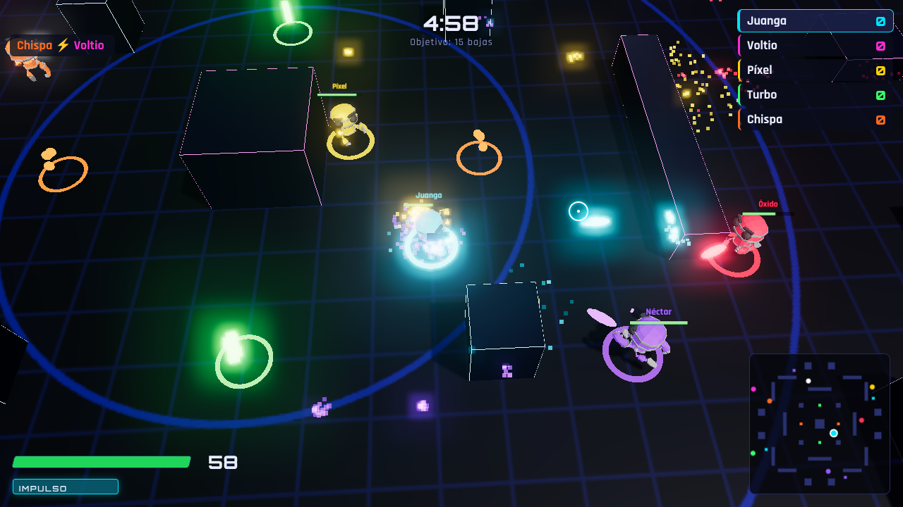

<div align="center">

# ⚡ NEÓN ARENA ⚡

**Shooter de arena en 3D para el navegador. Robots de neón, bots con IA y partidas online con tus amigos.**

### [▶ JUGAR AHORA](https://byjuanga.github.io/Neon-arena/)

Gratis, sin instalar nada y sin crear cuenta. Funciona en el navegador del ordenador.



</div>

## ¿Qué es?

Neón Arena es un juego de disparos visto desde arriba. Cada jugador controla un robot armado con un cañón de energía
dentro de una arena llena de obstáculos y luces de neón. Gana quien consigue antes el número de bajas acordado
(10, 15 o 25), o quien tiene más bajas cuando se acaban los 5 minutos.

Se puede jugar **solo contra bots** o **online con hasta 8 personas**. Basta con pasar un enlace a tus amigos.

## Características

- 🌐 **Multijugador online de 2 a 8 jugadores** con código de sala. Se puede entrar con la partida empezada.
- 🤖 **Bots con IA** en tres dificultades: apuntan adelantándose a tu movimiento, esquivan, se cubren y van a por vida cuando están heridos.
- 💥 **Objetos**: vida, disparo triple, velocidad y escudo.
- ⚡ **Impulso**: un acelerón rápido para esquivar disparos.
- 🎨 **Gráficos 3D** con robots animados, sombras, brillo de neón y explosiones de partículas.
- 🎵 **Música y efectos de sonido** generados en el propio navegador.
- 💬 **Chat** en la partida (tecla T) y en la sala de espera.
- 🗺️ Minimapa, lista de bajas, clasificación y avisos de racha («¡Doble eliminación!»).
- 🎚️ Calidad gráfica ajustable para ordenadores menos potentes.

## Controles

| Tecla | Acción |
|---|---|
| <kbd>W</kbd> <kbd>A</kbd> <kbd>S</kbd> <kbd>D</kbd> o flechas | Moverse |
| Ratón | Apuntar |
| Clic izquierdo | Disparar (mantén pulsado) |
| <kbd>Espacio</kbd> o <kbd>Shift</kbd> | Impulso |
| <kbd>Tab</kbd> | Clasificación |
| <kbd>T</kbd> o <kbd>Enter</kbd> | Chat |
| <kbd>Esc</kbd> | Pausa y opciones |

## Cómo jugar con amigos

1. Entra en **https://byjuanga.github.io/Neon-arena/**, escribe tu nombre y elige un color.
2. Pulsa **Crear sala online**. Te aparece un código de 5 letras, por ejemplo `K7MXQ`.
3. Pulsa **Copiar invitación** y mándala por WhatsApp o Discord.
4. Tus amigos abren el enlace y pulsan **Unirse**.
5. Añade bots si queréis ser más y pulsa **Empezar partida**.

> **Importante:** quien crea la sala hace de servidor. Tiene que dejar la pestaña del juego abierta y en primer plano;
> si la minimiza, la partida se congela para todos.

**Si alguien no puede conectarse**, suele ser por la red (universidades, empresas, algunos cortafuegos).
Que pruebe con otra conexión, por ejemplo compartiendo datos desde el móvil.

<details>
<summary><b>Objetos de la arena</b></summary>

| Objeto | Color | Efecto |
|---|---|---|
| Vida | 🟩 verde | Recupera 40 puntos de vida |
| Disparo triple | 🟧 naranja | Disparas tres proyectiles en abanico durante 8 s |
| Velocidad | 🟦 cian | Corres un 45 % más rápido durante 8 s |
| Escudo | 🟪 violeta | Recibes un 60 % menos de daño durante 8 s |

Los objetos vuelven a aparecer 12 segundos después de recogerlos.
</details>

## Cómo funciona

El juego es una página web estática: HTML, CSS y JavaScript, sin servidor propio.
**GitHub Pages** lo aloja gratis y lo actualiza cada vez que se suben cambios a la rama `main`.

Para el online, los navegadores de los jugadores **se conectan directamente entre sí** (WebRTC, con la librería
[PeerJS](https://peerjs.com/)). El navegador de quien crea la sala ejecuta la partida y envía el estado a los demás
20 veces por segundo. Cada invitado predice su propio movimiento para que los controles respondan al instante.

La explicación completa está en [docs/COMO-FUNCIONA.md](docs/COMO-FUNCIONA.md).

## Añadir personajes nuevos

Los personajes son modelos 3D en formato **.glb** con animaciones. Para añadir uno:

1. Copia el archivo en `assets/models/`.
2. Añade una entrada en `CHARACTERS` dentro de [`src/config.js`](src/config.js):
   ```js
   {
     id: 'soldado', name: 'Soldado', url: 'assets/models/soldado.glb',
     height: 1.9,            // altura en el juego (se escala solo)
     tint: 'NombreMaterial', // material que se pinta con el color del jugador
     anims: { idle: 'Idle', run: 'Run', death: 'Death', victory: 'Dance', hit: 'Hit' },
   }
   ```
   Los nombres de `anims` tienen que coincidir con los de las animaciones del archivo. Puedes verlos arrastrando
   el .glb a https://gltf-viewer.donmccurdy.com/

**Dónde conseguir modelos animados gratis:**
- [Quaternius](https://quaternius.com) y [Kenney](https://kenney.nl/assets): packs de personajes con licencia libre (CC0).
- [Mixamo](https://www.mixamo.com): añade esqueleto y animaciones a cualquier personaje humanoide.
- [Meshy](https://www.meshy.ai) o [Tripo](https://www.tripo3d.ai): crean un modelo 3D a partir de una imagen
  (por ejemplo, un dibujo hecho con ChatGPT). Después se anima en Mixamo.

## Probarlo en tu ordenador

Hace falta un servidor local, porque el navegador no deja cargar modelos 3D abriendo el archivo con doble clic.
Con Python instalado, en la carpeta del proyecto:

```bash
python -m http.server 8000
```

y abre http://localhost:8000

## Estructura del proyecto

```
├── index.html          Interfaz: menús, sala de espera y HUD
├── src/
│   ├── main.js         Menús, conexión online, controles y bucle principal
│   ├── sim.js          Reglas del juego: movimiento, disparos, objetos e IA de los bots
│   ├── render.js       Gráficos 3D: arena, robots, efectos y cámara
│   ├── config.js       Ajustes: velocidades, daño, mapa, personajes
│   ├── audio.js        Música y efectos de sonido
│   └── style.css       Estilos de la interfaz
├── assets/             Modelos 3D e icono
├── vendor/             Three.js y PeerJS (incluidos para no depender de servicios externos)
└── docs/               Documentación e imágenes
```

## Créditos

- Modelo *RobotExpressive*: [Tomás Laulhé (Quaternius)](https://quaternius.com), CC0 1.0. Modificaciones de Don McCurdy.
- [Three.js](https://threejs.org) (MIT) para los gráficos 3D.
- [PeerJS](https://peerjs.com) (MIT) para las conexiones online.
- Fuentes [Orbitron](https://fonts.google.com/specimen/Orbitron) y [Rajdhani](https://fonts.google.com/specimen/Rajdhani) de Google Fonts.

## Licencia

El código del juego se publica bajo la [licencia MIT](LICENSE). El contenido de terceros conserva su propia licencia:
el modelo `assets/models/RobotExpressive.glb` es CC0 1.0, Three.js es MIT (`vendor/three/LICENSE`) y PeerJS es MIT
(`vendor/PEERJS-LICENSE`).
